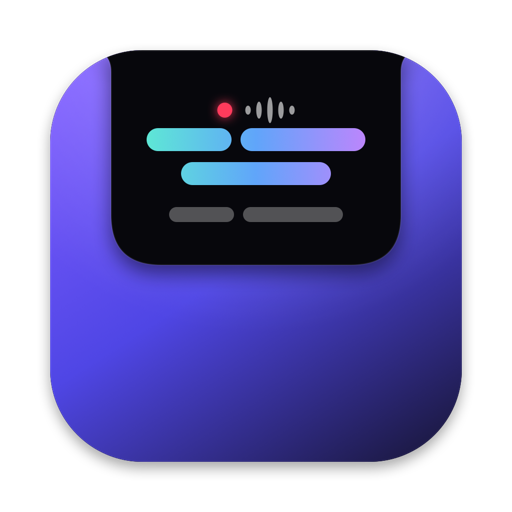

<p align="center"></p>

<h1 align="center">NotchSub</h1>

<p align="center"><b>Live subtitles and translations for any audio on your Mac, shown in a panel that drops down from the notch.</b><br>
Free, open source and fully on-device.</p>

<p align="center">
  <a href="https://github.com/wutlu/notchsub/releases/latest/download/NotchSub.dmg"><b>Download for Mac</b></a> ·
  <a href="https://wutlu.github.io/notchsub/">Website</a>
</p>

---

Click the notch and NotchSub starts listening to whatever your Mac plays (YouTube, Zoom, podcasts, streams). It shows the translation in large text with the original line underneath.

- **Private.** Speech recognition ([WhisperKit](https://github.com/argmaxinc/WhisperKit)) and translation ([Apple Translation](https://developer.apple.com/documentation/translation)) run on your Mac. No account, no cloud.
- **System audio only.** Uses a Core Audio process tap. The microphone is never used.
- **99 spoken languages**, translated into ~20 languages on-device. The interface is localized in 20 languages and follows your system language.
- **Native and lightweight.** Swift, SwiftUI and AppKit, accelerated by the Neural Engine.

## Install

**One line (recommended):**

```bash
curl -fsSL https://wutlu.github.io/notchsub/install.sh | bash
```

**Or** download [`NotchSub.dmg`](https://github.com/wutlu/notchsub/releases/latest/download/NotchSub.dmg) and drag the app into Applications. The app isn't notarized yet, so the first time you open it, go to System Settings → Privacy & Security and click **Open Anyway**.

Requirements: Apple Silicon Mac (M1 or newer), macOS 15 Sequoia or later.

On first launch NotchSub downloads the Whisper model (~630 MB) and compiles it for the Neural Engine, which can take several minutes. Later launches take a few seconds. To get translations, install the language pack once in Settings → Translation pack → Download.

## Build from source

```bash
git clone https://github.com/wutlu/notchsub && cd notchsub
./scripts/build-app.sh --run          # builds build/NotchSub.app and opens it
```

Requires Xcode 26 / Swift 6.2.

| Path | What's inside |
|---|---|
| `Sources/NotchSub/Notch` | Notch panel (NSPanel), shape, click handling, subtitle UI |
| `Sources/NotchSub/Audio` | System audio capture (process tap), 16 kHz resampling, VAD |
| `Sources/NotchSub/Transcription` | WhisperKit engine and streaming partial/confirmed segmentation |
| `Sources/NotchSub/Translation` | Apple Translation session |
| `Sources/NotchSub/Pipeline` | Audio → text → translation → UI |
| `scripts/localizations.py` | All UI strings in every language (regenerates `Resources/Localization`) |
| `design/make-icon.swift` | The app icon, drawn in code (`scripts/make-icns.sh`) |
| `docs/` | Website (GitHub Pages) and `install.sh` |

Test the speech pipeline without using the speakers:

```bash
say -o /tmp/t.aiff "Hello, this is a test."
.build/arm64-apple-macosx/release/NotchSub --selftest /tmp/t.aiff
```

### Releasing

```bash
./scripts/release.sh 0.2.0 --publish   # builds the DMG and zip, then creates a GitHub release
```

## Contributing

Issues and PRs are welcome. To add or fix a translation of the interface, edit `scripts/localizations.py` and run `python3 scripts/localizations.py`.

## License

[MIT](LICENSE)
